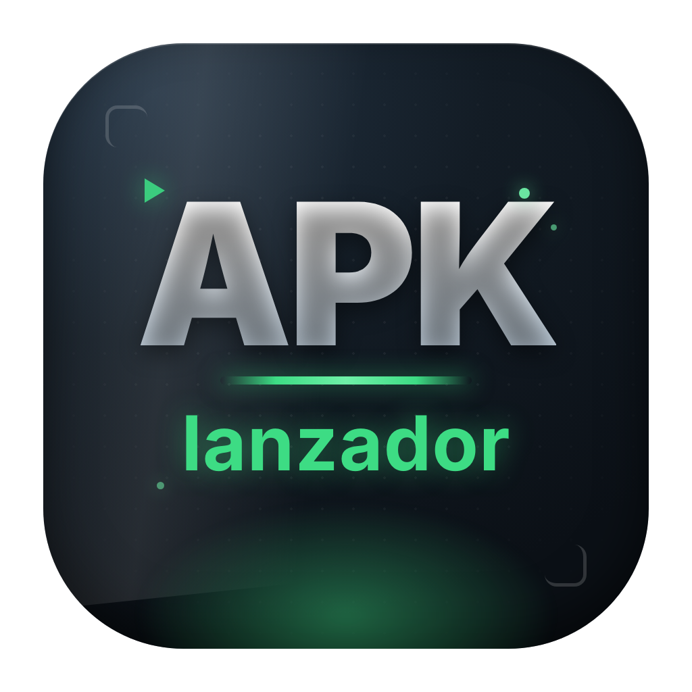
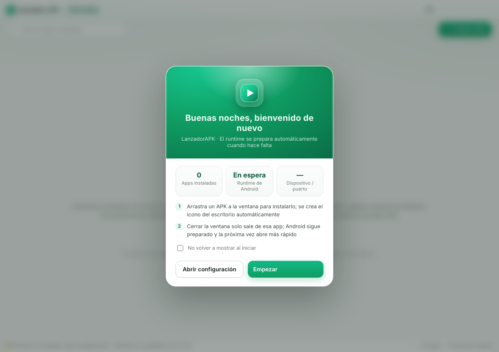

# Lanzador APK

<p align="center"></p>

**Ejecuta apps Android en Windows como si fueran programas normales.** Haces doble clic en un `.apk`, se instala solo, aparece un icono en el escritorio y la app se abre en su propia ventana.

> Lanzador APK es una versión derivada de [ApkStart](https://github.com/RoutineMiku/apkstart) (licencia MIT, © ApkStart contributors / RoutineMiku), traducida al español y con cambios de seguridad y de configuración regional. Ver [Cambios respecto al original](#cambios-respecto-al-original).



## Qué hace

- **Doble clic en un APK para instalarlo.** Asocia los archivos `.apk`; al abrir uno se analiza, se instala y se crea el acceso directo, sin abrir la interfaz de un emulador.
- **Un icono por app.** Extrae el icono real del APK, crea accesos directos en el escritorio y en el menú Inicio, y cada app aparece por separado en la barra de tareas.
- **Cada app en su ventana.** Por dentro usa el emulador oficial de Android (Android Emulator + imagen Android 14 de Google). La ventana toma el nombre y el icono de la app y se ajusta a vertical u horizontal según el APK.
- **Carpeta compartida.** `%USERPROFILE%\LanzadorAPKShared` se sincroniza en ambos sentidos con `/sdcard/LanzadorAPKShared` dentro de Android.
- **Se recupera sola.** Si una app se cierra al abrir, reintenta, restablece sus datos o le concede permisos; si el arranque falla, prueba configuraciones más conservadoras.
- **Diagnóstico integrado.** Revisa virtualización, tarjeta gráfica, memoria, disco y conexión, y ofrece reparaciones con un clic.

## Requisitos

- Windows 10 2004 (build 19041) o superior, 64 bits.
- 8 GB de RAM como mínimo (recomendado 16 GB) y unos 10 GB libres en disco.
- Virtualización activada en la BIOS (Intel VT-x o AMD SVM) y la característica **Plataforma del hipervisor de Windows**. Sin ella funciona, pero con emulación por software, mucho más lenta.

## Descargar

En [Releases](https://github.com/zaiddia/Lanzador-APK/releases) se publican:

| Archivo | Para qué |
|---|---|
| `LanzadorAPK-<versión>-Setup.exe` | Instalador completo (incluye el runtime de Android, no necesita internet al instalar). |
| `LanzadorAPK-v<versión>-win64-portable.zip` | Versión portátil ligera: descarga el runtime (~1,5 GB) la primera vez. |
| `LanzadorAPK-runtime-v<versión>.zip` | Runtime que usa la versión portátil. |
| `SHA256SUMS.txt` | Sumas SHA-256 de todos los archivos anteriores. |

## Cambios respecto al original

**Idioma y región**
- Toda la interfaz, los mensajes, avisos e informes de diagnóstico están en español (Latinoamérica).
- Android arranca en **español (es-419)** y con la **zona horaria de tu PC**; el original forzaba chino y la hora de Shanghái.
- El teclado pinyin (chino) ya no se instala en silencio; es opcional y viene desactivado.
- El instalador NSIS está en español.

**Privacidad y red**
- Se quitaron los espejos chinos de GitHub (`ghfast.top`, `gh-proxy.com`), la fuente Gitee y el espejo de Electron `npmmirror.com`.
- La comprobación de conexión de Android usa el servidor estándar de Google (`connectivitycheck.gstatic.com`) en vez del de Xiaomi.
- Se quitaron los DNS de Alibaba/Tencent. Por defecto Android usa los DNS de tu PC; la opción «DNS públicos» (Cloudflare y Google) es opcional.
- Se quitaron los códigos QR y enlaces de WeChat/Douyin.

**Seguridad**
- **Las actualizaciones se verifican con SHA-256.** El actualizador solo instala un paquete si su suma coincide con la publicada en GitHub (campo `digest` de la API o `SHA256SUMS.txt`). Si no hay suma publicada, no instala nada y abre la página de Releases. La suma siempre se consulta en github.com, aunque uses un espejo para descargar.
- El paquete del runtime también se verifica con SHA-256; si no se puede verificar, se descarga por componentes desde Google.
- El motor del emulador y las imágenes de Google se verifican con el SHA-1 que Google publica en su repositorio del SDK.
- Validación del idioma y la zona horaria antes de pasarlos a `adb shell`.

**Correcciones**
- En equipos con poca RAM (8 GB, 2 núcleos), los dos últimos reintentos de arranque eran idénticos y se perdían hasta 4 minutos repitiendo el mismo intento. Ahora no se repiten.

## Compilar desde el código

```powershell
git clone https://github.com/zaiddia/Lanzador-APK.git
cd Lanzador-APK
npm ci
npm test            # pruebas automáticas (no necesitan emulador)
npm start           # abre la app en modo desarrollo
npm run pack        # versión portátil ligera  → dist/
npm run pack:full   # versión portátil completa (necesita build/runtime)
npm run build:exe   # instalador NSIS completo
```

Se necesita Node.js 20 o superior. Las pruebas corren también en Linux; la app en sí solo funciona en Windows.

## Publicar una versión

1. Sube la versión en `package.json`.
2. Crea y sube una etiqueta: `git tag v0.7.0 && git push origin v0.7.0`.
3. El flujo `.github/workflows/release.yml` compila la versión portátil, el instalador completo y el paquete del runtime, los sube a Releases y publica `SHA256SUMS.txt` (necesario para que el actualizador de la app instale la versión).

## Probar en Windows

Después de instalar, revisa al menos esto:

1. **Primer arranque.** Configuración → Diagnóstico → «Iniciar diagnóstico»: la virtualización y la Plataforma del hipervisor de Windows deben salir en verde.
2. **Instalar un APK.** Arrastra un APK a la ventana; debe aparecer su icono en el escritorio y en el menú Inicio.
3. **Abrir la app.** Doble clic en el icono: se abre en su propia ventana, con el nombre de la app en la barra de título.
4. **Idioma y hora.** Dentro de Android, Ajustes → Sistema → Idioma debe decir «Español (Latinoamérica)» y la hora debe coincidir con la de tu PC.
5. **Internet.** Abre una app que use internet (por ejemplo un navegador) y comprueba que carga.
6. **Carpeta compartida.** Copia un archivo a `%USERPROFILE%\LanzadorAPKShared` y comprueba que aparece en Android en `/sdcard/LanzadorAPKShared`.
7. **Actualización.** Con dos versiones publicadas, «Buscar actualizaciones» debe descargar, verificar e instalar la nueva.

Si algo falla, usa Configuración → Diagnóstico → «Exportar informe de diagnóstico».

## Microsoft Store

Para publicar en la Store, pon tu propio valor de *Publisher* de Partner Center en `electron-builder.yml` (`appx.publisher`) o pásalo con `LANZADORAPK_MSIX_PUBLISHER`, y luego ejecuta `npm run build:msix`. Mientras tenga el valor de ejemplo, el script se niega a generar el paquete.

## Estructura

| Carpeta | Contenido |
|---|---|
| `src/main.js` | Proceso principal de Electron |
| `src/ui/` | Interfaz (HTML/CSS/JS) |
| `src/core/` | Lógica: emulador, adb, instalación de APK, actualizaciones, diagnóstico |
| `src/core/win/` | Scripts de PowerShell para controlar ventanas en Windows |
| `src/core/brand.js` | Nombre del producto y repositorio de GitHub usados para actualizaciones |
| `build/` | Empaquetado (portátil, NSIS, MSIX, iconos) |
| `test/` | Pruebas automáticas |
| `docs/` | Documentación técnica del proyecto original (en chino) |

Los comentarios del código siguen mayoritariamente en chino, como en el original; la documentación técnica original está en `docs/README-original-zh.md` y el resto de `docs/`.

## Licencia

MIT. Se conserva el aviso de copyright del proyecto original; ver [LICENSE](LICENSE).
